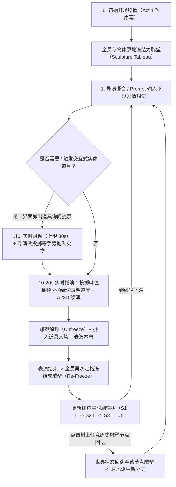

# StageState — 无限开放剧情 × 雕塑定格 × 30s 投掷道具演进方案 (`Design_Infinite_Sculpture.md`)

> 本文档定义 StageState 从「固定 4 幕时间旅行短剧」升级为 **「无限续演 × 演完冻成雕塑 × 演中实时 30s 投掷实体道具入戏 × 侧边实时剧情树回溯」** 的主线架构、接口扩展与三端协同规范。

---

## 1. 核心主线体验闭环（Open-Ended Living Sculpture Loop）

### 五个关键交互节拍

1. **冷开场 → 首次成雕（Cold Open & Initial Freeze）**
   - 进入舞台后先播放极简初始剧情（如 Scene 1：雨夜花房内的莉亚、黑猫尼克斯与桌上的蓝玫瑰水晶花瓶）。
   - 初始段落结束瞬间，全员动作、粒子与呼吸动画停驻并进入**雕塑定格态（Sculpture Freeze）**，等待导演下达第一条接管指令。
2. **无限续演（Unbounded Scene Extension）**
   - 不设第 4 幕终点；玩家每次用语音或文本 Prompt 输入剧情后，系统读取**当前所处雕塑节点的世界状态快照（角色坐标、朝向、持物、破损/完整状态、`environment_notes`）**，向后连续推演生成 `Scene N+1`（`N = 1, 2, 3, ... ∞`）。
3. **演中「实物询问 + 30s 实时投掷入戏」**
   - 当剧情推演中涉及新道具或来到互动节点时，界面**主动弹出提示询问**并开启**实时摄像头录像（最高 30s，支持做出动作后随时提前停止或自动捕捉投掷完成）**。
   - 用户用手持实体物品做出**“投掷 / 抛入（Throw-in Gesture）”**动作后，系统从 30s `.webm` 中定位投掷瞬间最清晰的实物帧，通过 Nano Banana 2.1 + 洪泛抠像转为 0 绿边透明 RGBA 道具，并携带抛物线轨迹（`throw_arc`）飞入 3D 舞台参与本幕表演。
4. **10–20s 实时推演 → 解封表演 → 演完再成雕**
   - 推演期间 3D 舞台在 `<1s` 内率先展示预设动作/抛物线预演占位，并发渲染完成（目标 **10–20s 窗口**）后**全体角色与道具从雕塑解封（恢复全彩与动效）表演这一幕**；
   - 表演到达本幕最后一拍时，所有人物和物品**重新冻结定格为雕塑**，等待下一轮导演输入。
5. **侧边实时剧情树与历史回退分叉（Sidebar Story Tree）**
   - 页面侧边栏实时显示生长中的剧情树，每个节点标明幕数、关键道具、分支标签与定格缩略图；
   - 点击侧边栏**任意历史节点（例如回到 S2 的雕塑）**，舞台立即回溯至当时的雕塑快照，再次输入语音/Prompt 或投掷新道具即可从该节点**派生出平行新分支**。

---

## 2. 10–20s 实时推演延迟预算与技术方案

此前标准质量通道采用 `Best-of-2` 双候选 + 跨机位重拍，常耗时 25–35s；为稳定达成 **10–20s** 实时解封体验，采用以下并发流水线：

| 环节 | 耗时预算 | 实现要点 |
| :--- | :---: | :--- |
| `parse_director_input` + `extend` 剧情规划 | **1.5 – 3.0s** | Gemini 4 Neon 仅生成 **单幕 `Scene N+1`** 结构化 JSON（比一次规划 4 幕快 3 倍以上） |
| 30s 投掷手势抽帧 + `create_prop`（与规划/阶段衔接并发） | **0.2s + 11–14s** | 检测到用户完成投掷动作后立即停止录像；放宽 `.webm` 解码窗口至 `1200` 帧（30s）+ 帧差峰值检测，直接并发调 Nano Banana 2.1 |
| Live Fast Mode 视频渲染（Omni Flash `360p / 4s`） | **16 – 18s** | 实时续演模式默认 **`DUAL_TAKE_COUNT=1`（单拍直出）**，Three.js 3D 舞台 `<1s` 先行解封表演无缝过渡；`qa()` 改用 `Decisions API` 单次极速核验（`~0.8s`） |
| **总感知等待** | **~12 – 19s** | 3D 舞台实时预演即时响应 + AI 成片 `<= 20s` 内平滑切换并触发结尾成雕定格 |

---

## 3. 数据契约与 API 扩展提案（保持向后兼容 1–4 幕基准）

### 3.1 `shared/schema.json` & `backend/schemas.py`（全向后兼容）

- `DirectorInputParsed`:
  - 放宽 `target_scene_id: int = Field(default=2, ge=1)`（去掉 `le=4` 上限，支持 `Scene 5, 6, ... ∞`）。
  - 新增 `mode: Literal["extend", "fork"] = "extend"`（从当前节点续演 `N+1` vs 回溯分支分叉）。
  - 新增 `needs_prop_prompt: bool = False` 与 `prop_prompt_hint: Optional[str] = None`（指示前端弹出道具交互提示）。
- `StagePropState`:
  - 新增 `entry_motion: Literal["place", "throw_arc", "held"] = "place"` 与 `entry_origin: Optional[list[float]] = None`（描述投掷飞入起落轨迹）。
- `Scene`:
  - 新增 `end_freeze_mode: Literal["sculpture", "none"] = "sculpture"`（每幕播完自动进入雕塑定格）。
  - 新增 `parent_scene_id: Optional[int] = None`，便于前端侧边剧情树精准连接跨幕与跨分支父子节点。

### 3.2 新增 / 升级端点

- `POST /api/director/extend`（或扩展 `/api/director/fork` 增加 `mode` 参数）：
  - 接收当前 `branch_id`、`from_scene_id`、语音/文本指令及可选 `clip`；
  - 从 `from_scene_id` 末尾定格快照延续世界状态，若 `from_scene_id == len(branch.scenes)` 则追加 `Scene N+1` 到原分支；若 `from_scene_id < len(branch.scenes)` 则自动从该历史雕塑节点分叉创建新分支 `branch_v<N>`。
- `POST /api/media/create-prop`：
  - 扩展 `.webm` 接收时长至 **30s**；支持新增参数 `detect_throw_peak: bool = True`（当 `frame_timestamp_sec` 未显式指定时自动检测画面抛物线运动峰值前一清晰帧）。

---

## 4. 三机目录边界内的落地分工

### A. Master (`P1` · `backend/schemas.py`, `backend/main.py`, `backend/director/**`)
1. 解除 `target_scene_id <= 4` 硬限制，补充 `mode` / `end_freeze_mode` / `entry_motion` 可选字段（默认值保证现有 `mock_branch_1..4` 与所有既有评测 100% 兼容）。
2. 在 `neon_director.py` 增加 `extend_single_scene()`：只生成 `Scene N+1` 单幕（控制规划延时 `<3s`），严格承接上一尊雕塑的 `WorldState` 与 `environment_notes`。
3. 在 `hydrogen_judge.py` 扩展提示词识别「剧情是否需要用户输入实体道具 / 是否存在投掷手势」，回传 `needs_prop_prompt` 与 `prop_prompt_hint`。

### B. worker-1 (`P2` · `backend/media/**`, `backend/assets/**`)
1. **`prop_maker.py` 30s 投掷录像兼容 + 运动峰值抽帧**：
   - 将 `_extract_image_from_bytes()` 顺序解码上限从 `150` 帧（5s）扩展至 `1200` 帧（30s @ 30fps），支持全长 30s 摄像头 `.webm`；
   - 新增 `_detect_throw_peak_frame_idx()`：通过相邻帧中心前景差分寻找“物体抛入画面、运动速度放缓最清晰”的目标帧，与显式 `frame_timestamp_sec` 双重保底。
2. **`video_renderer.py` Live Fast Mode（10–20s）与雕塑定格尾部锚定**：
   - 增加 `fast_live_mode: bool = False`：续演时切换单候选并行出片 + Decisions API 快速单次验片，总耗时稳定控制在 `16–19s`；
   - 当 `scene.end_freeze_mode == "sculpture"` 时，自动在 `_build_shot_prompt()` 注入末尾静止构图指令（人物动作收束、物理落地后停滞成雕塑定格尾帧），确保 AI 尾帧无缝衔接前端 3D 雕塑冻结状态。

### C. worker-2 (`P3` · `frontend/**`)
1. **3D 雕塑冻结控制器（`ThreeStageManager.ts`）**：
   - 新增 `setSculptureFrozen(true/false)`：每幕播完自动冻结呼吸/行走/粒子动画，并将角色与道具贴图切换为低饱和度月光石膏/冷银雕塑着色效果（支持鼠标绕雕塑检视）；收到新指令推演就绪后平滑解封恢复全彩表演。
   - 新增 `spawnThrownPropAnimation()`：新投掷生成的透明道具按抛物线弧线从镜头方向飞落至圆桌/角色手心/地面。
2. **侧边实时剧情树（`SidebarStoryTree`）**：
   - 将剧情树改造为**右侧/左侧常驻可折叠侧边栏**，随每轮续演实时追加 `S(N+1) 🗿` 节点；点击任意历史雕塑节点即可回退到该状态并提示「从当前雕塑派生新分支」。
3. **演出中「道具询问 + 30s 投掷实时录像弹窗」**：
   - 当用户指令需要加入道具或响应 `needs_prop_prompt` 时弹出实时录像 Modal（30s 倒计时进度条 + 实时画面 +「抛出完成 / 立即生成」按钮），录得手势抛入动作后立即触发 `create-prop` 与 3D 抛物线落物动画。
