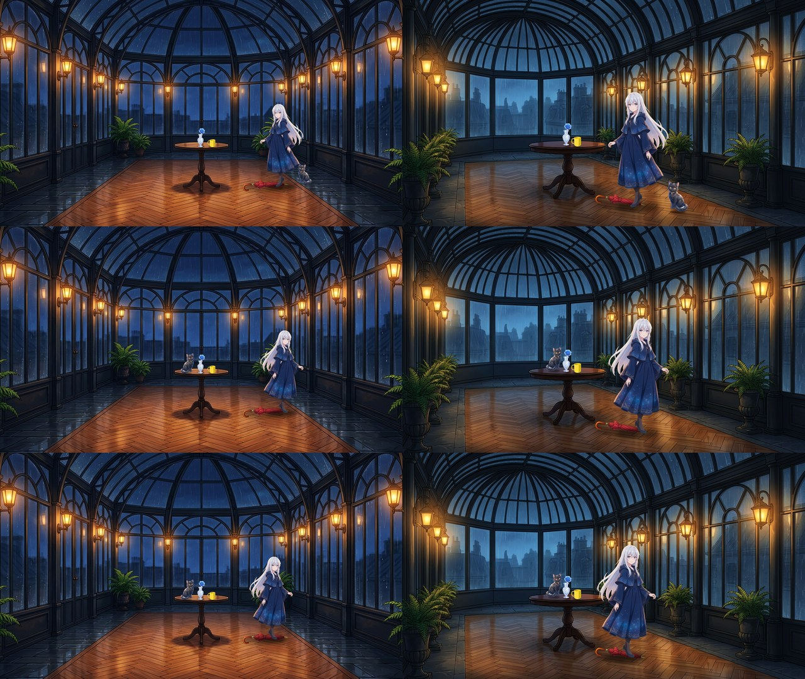
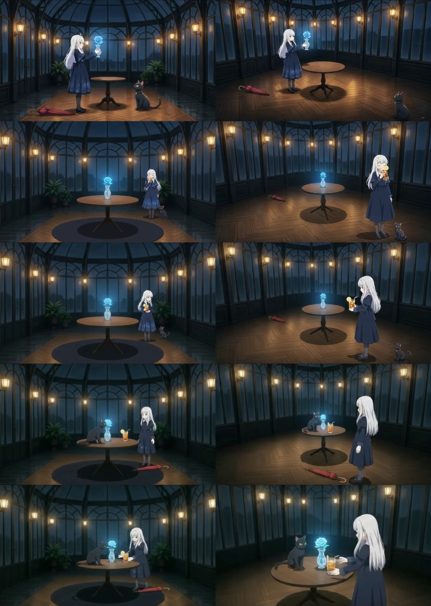

# 阶段 2：3D 做底的对比实验

## 结论先说

**对比实验还没跑。** 比赛发的 API key 在 2026-11-23 已失效（所有模型调用返回 401，2026-11-22 中午还能用）。视频生成和自动判题都要这把 key，所以三种做法的打分表现在是空的。

代码、开关、评测脚本都已写好并离线测过。换上能用的 key 之后，按文末的命令跑，约 20 到 30 分钟出表。

默认做法没有改，仍是 `prev_tail`（原流程）。在看到分数之前不应该换默认值。

## 四种做法

用环境变量 `RENDER_BASE` 切换。

| 值 | 做法 | 每幕多出的输入 |
| :-- | :-- | :-- |
| `prev_tail` | A（现状）：上一幕的尾帧加文字 | 无 |
| `stage3d` | B：起始帧由 3D 舞台合成 | 1 张合成图 |
| `stage3d_first_last` | B2：起始帧和结束帧都由 3D 舞台合成，视频模型只补中间的动作 | 2 张合成图 |
| `stage3d_video` | C：3D 走位片交给视频模型重绘 | 1 张合成图加 1 段视频 |

另有 `SPLIT_RESOLUTION=1080p`，分屏用 1080p 生成，裁出来每个机位 960x540。

### 和原计划不一样的地方

原计划的做法 B 是「3D 画面交给图片模型重绘成二次元起始帧」。实际做的时候改成了**直接合成**，不经过图片模型：

- 房间用两张固定的底图（`backend/assets/stages/plate_cam_a.png`、`plate_cam_b.png`）。
- 人物和道具的抠图按 3D 坐标投影后贴上去，大小按真实身高算。
- 合成一帧 0.2 秒，不调用任何模型。

这样改的理由：位置和数量是算出来的，不会错。之前「拖动后让图片模型重画起始帧」实测过，猫挪对了，女孩只挪了一部分。图片模型是这条链路里不准的那一环，所以把它拿掉。

代价：人物是站立姿势的抠图，B 机位里人物的朝向和 A 机位一样（都是正面），不是转了 45 度的样子。提示词里要求视频模型把右边画面里的人物转到正确朝向。这一点效果如何，要跑了才知道。

`backend/media/build_stage_plates.py` 可以用图片模型从 3D 几何重新画两张底图。现在的底图是从已有的空房间图裁出来的，再把相机参数校准到和图里的桌子重合（`shared/viewpoints.json`）。



上图是基准剧本第 5、6、7 幕的合成帧，左边 A 机位，右边 B 机位。猫在桌上、伞躺在地上、花瓶和杯子各一个，两个机位位置一致。

## 做法 A 的现有成绩和实际问题

Gemini 在阶段 1 跑出的做法 A 成绩是 79/90（87.8%），失分集中在位置（66.7%）和跨机位同步（72.2%）。

我把做法 A 六幕的结尾画面排在一起看了，有三个问题分数里没体现出来：



1. **房间会变。** 第 2 幕到第 3 幕之间桌子下面多出一块圆地毯，桌子大小也变了。这一幕之前有一次拖动人物，起始帧被图片模型重画过，房间跟着被重画。幕间连贯那一项却是 12/12 全过，说明这道题问得太松。
2. **B 机位会漂。** 最后一幕 B 机位明显推近了，和前面几幕不是同一个机位。链条越长漂得越多。
3. **状态和旁白对不上。** 第 6 幕旁白写猫跳上桌，状态里猫却在地上（旧规则会把桌子范围内的角色推出去）。于是第 7 幕的题目问「猫在地上吗」，成片里猫在桌上，判错。这不是视频的错，是状态表达不了「在桌上」。

第 3 点已经修了：角色状态加了 `elevation`（地上或桌上），题目改成从这个字段出题。所以**题目集已经从 v1 变成 v2，做法 A 的 79/90 不能直接和新做法比**，要用 v2 题目重新判一次。

第 1、2 点正是 3D 做底要解决的：每一幕的起始帧都从同一张底图和同一组相机参数合成，房间和机位不会随链条漂移。

## 已经离线验证的

- 合成帧：两个机位的投影和浏览器里 Three.js 的投影误差 0.001 像素（`frontend/scripts/test_viewpoints.mjs`）。
- 三种 3D 做法的整条流程：把视频生成和判题换成假的，确认合成帧、结束帧、走位片都按预期传给视频模型，分屏片被裁成两段，尾帧落盘（`backend/test_stage3d_pipeline.py`，7 项全过）。这只说明管线通，不说明生成质量。
- 提示词里没有会被画进画面的词（摄像机、三脚架、身高数字）。

## 没验证的

- 视频模型从合成帧出发，成片是否自然，会不会留下抠图的生硬感。
- 首尾帧模式下分屏画面是否稳定。之前给视频模型传第二张图时出现过成片开头变成那张图的问题，首尾帧是模型支持的用法，但分屏下没测过。
- `interactions` 接口是否接受视频输入做重绘（做法 C）。代码按「接受」写的，不接受会报错并退回原流程。
- 1080p 的耗时和花费。

## 拿到 key 之后怎么跑

把新 key 写进 `.env` 的 `GEMINI_API_KEY`，然后：

```bash
# 同一套世界状态（branch_v7 的六幕），四种做法各渲染一遍并判题
.venv/bin/python backend/media/eval_video_consistency.py --states-from branch_v7 --render-base prev_tail
.venv/bin/python backend/media/eval_video_consistency.py --states-from branch_v7 --render-base stage3d
.venv/bin/python backend/media/eval_video_consistency.py --states-from branch_v7 --render-base stage3d_first_last
.venv/bin/python backend/media/eval_video_consistency.py --states-from branch_v7 --render-base stage3d_video
# 可选：1080p
.venv/bin/python backend/media/eval_video_consistency.py --states-from branch_v7 --render-base stage3d_first_last --resolution 1080p
# 汇总成对比表
.venv/bin/python backend/media/eval_video_consistency.py --compare
```

每条命令渲染 6 幕（每幕约 30 秒）加判 90 道题。结果写在 `backend/assets/eval/video_consistency_<做法>.json`，对比表写在 `video_consistency_compare.json`。

注意：比赛用的模型名（`gemini-4-neon`、`gemini-omni-flash-preview` 等）普通 key 不一定有权限。没有的话要在 `.env` 里用 `MODEL_VIDEO` 等变量换成可用的模型。

分数最高的做法，把 `backend/config.py` 里 `RENDER_BASE` 的默认值改成它。如果三种 3D 做法都不比 A 明显好，如实写在这里，不要挑数据。
